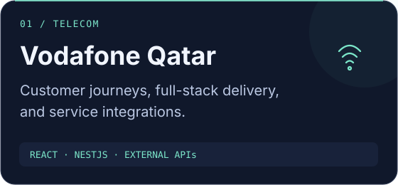
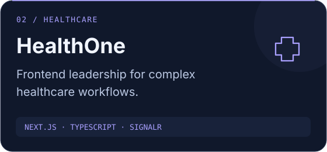
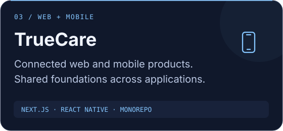
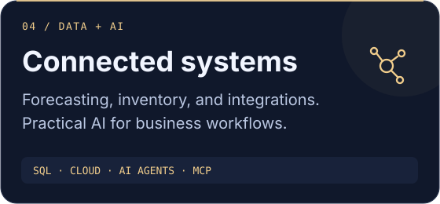

<picture>
  <source media="(max-width: 640px)" srcset="assets/hero-mobile.svg" />
  
</picture>

  
  
  

**[THE WORK](#-selected-work)** &nbsp; / &nbsp; **[THE STACK](#-the-stack)** &nbsp; / &nbsp; **[THE ACTIVITY](#-github-in-motion)**

 

## ✦ A little about the builder

I'm **Hasham**, a senior full-stack developer working across **React / Next.js, Node.js / NestJS, SQL, and cloud**. I build customer-facing products and the integrations behind them, with experience in web, mobile, technical leadership, and enterprise systems.

🔭 **Current focus:** AI agents, MCP integrations, and useful business workflows. 
🌱 **Going deeper:** Python, FastAPI, and LLMs. 
💬 **Always up for:** a good architecture discussion—or simplifying an unnecessarily complicated flow.

<picture>
  <source media="(max-width: 640px)" srcset="assets/build-flow-mobile.svg" />
  
</picture>

## ✦ Selected work

From customer journeys to connected business systems.

  
  
  
  

<strong>↳ The work behind the cards — my role and contributions</strong>

- **Vodafone Qatar / GigaHome:** React and NestJS delivery across customer journeys and services. Built GigaHome with React/Zustand and NestJS, led four developers, and developed the Starlink integration microservice for the EBU Self Care Portal.
- **HealthOne:** frontend lead using Next.js, React, TypeScript, and SignalR within a multidisciplinary Scrum team.
- **TrueCare:** web and mobile development with Next.js and React Native, including a monorepo for shared code.
- **Business systems:** forecast and inventory dashboards, SQL-backed ERP integrations, cloud services, and current AI-agent and MCP integration work.

## ✦ The stack

<h4>Interfaces &amp; experiences</h4>

React · Next.js · TypeScript · Vue · Nuxt · Tailwind · React Native

<h4>APIs &amp; data</h4>

Node.js · NestJS · Express · PostgreSQL · MySQL · MongoDB · SQL Server

<h4>Cloud &amp; delivery</h4>

Azure · AWS · Docker · Git · GitLab CI/CD · Firebase

<h4>AI &amp; what's next</h4>

Growing my Python, FastAPI, and LLM toolkit through ongoing learning.

## ✦ GitHub in motion

  
  

Provider snapshots may be cached; public GitHub activity is one part of my work. 
<a href="https://github.com/Hashamjavedofficial?tab=overview">Native contribution calendar</a> · <a href="https://github.com/Hashamjavedofficial?tab=repositories">All repositories</a> · <a href="https://github.com/pulls?q=is%3Apr+author%3AHashamjavedofficial">Pull requests</a>

## ✦ The public workbench

A few templates, experiments, and earlier learning projects you can explore.

**[📱 RN-BoilerPlateX](https://github.com/Hashamjavedofficial/RN-BoilerPlateX)** — a starting point for React Native apps. 
**[🔐 Next.js authentication](https://github.com/Hashamjavedofficial/nextjs-authentication-with-mongoose-next-connect)** — an experiment with Mongoose and next-connect. 
**[🌍 React OpenAQ Comparison](https://github.com/Hashamjavedofficial/React-OpenAQ-Comparison)** — exploring air-quality comparisons with React.

 

<strong><a href="mailto:hasham.hasham1@gmail.com">Email me</a> &nbsp; / &nbsp; <a href="https://www.linkedin.com/in/hashamjaved/">LinkedIn</a> &nbsp; / &nbsp; <a href="https://hashamjavedofficial.github.io/developerFolio/">Portfolio</a></strong>

