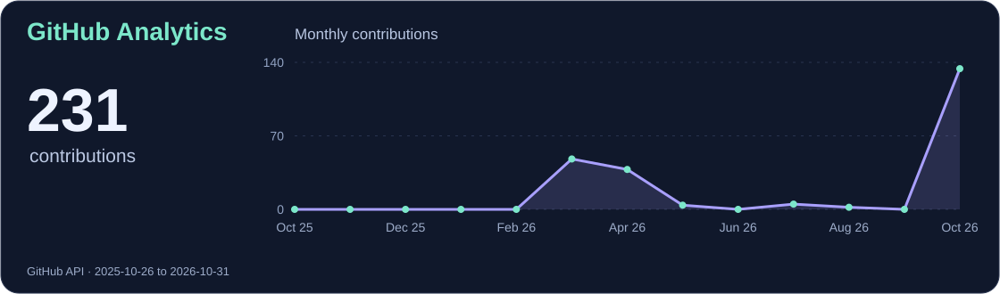

<picture>
  <source media="(max-width: 640px)" srcset="assets/hero-mobile.svg" />
  
</picture>

  
  
  

**[ABOUT](#about-me)** &nbsp; / &nbsp; **[ARSENAL](#tech-arsenal)** &nbsp; / &nbsp; **[ANALYTICS](#github-analytics)** &nbsp; / &nbsp; **[SNAKE](#-contribution-snake)**

## About Me

### Hey there, I'm Hasham Javed 👋

> 🚀 **Senior Full-Stack Developer · AI Agents · MCP Integrations**
>
> Building useful applications—and connecting the tools, APIs, and business data behind them.

I'm especially interested in the space where **AI agents meet real systems**: **MCP (Model Context Protocol)** integrations, practical workflows, and the full-stack foundations that make them useful.

| Focus | What's on my radar |
| :--- | :--- |
| 🔭 **Building** | **AI agents, MCP integrations, and connected web applications** |
| 🌱 **Exploring** | Python, FastAPI, generative AI, and LLMs |
| 💬 **Ask me about** | React, Next.js, NestJS, TypeScript, SQL, APIs, and cloud |
| ⚡ **My approach** | Stay curious. Make complex systems easier to use. |

## Tech Arsenal

<strong>🤖 AI Agents &amp; MCP</strong>

 

My focus: useful agents, MCP tools, and connecting business data.

 

<strong>🎨 Frontend Development</strong>

 

 

<strong>⚙️ Backend &amp; Architecture</strong>

 

 

<strong>🗄️ Databases &amp; Storage</strong>

 

 

<strong>☁️ Cloud &amp; Developer Tools</strong>

 

 

<strong>📱 Mobile &amp; Quality</strong>

 

 

<strong>🌱 Learning Lab</strong>

 

Currently deepening these skills through ongoing learning and experiments.

 

## GitHub Analytics

<a href="https://github.com/Hashamjavedofficial?tab=overview">
  <picture>
    <source media="(max-width: 640px)" srcset="assets/github-analytics-mobile.svg" />
    
  </picture>
</a>

  
  

Refreshed daily from GitHub. Public activity is one part of my work. 
<a href="https://github.com/Hashamjavedofficial?tab=overview">Native contribution calendar</a> · <a href="https://github.com/Hashamjavedofficial?tab=repositories">All repositories</a> · <a href="https://github.com/pulls?q=is%3Apr+author%3AHashamjavedofficial">Pull requests</a>

## 🐍 Contribution snake

<a href="https://github.com/Hashamjavedofficial?tab=overview">
  <picture>
    <source media="(prefers-reduced-motion: reduce) and (max-width: 640px)" srcset="assets/github-activity-mobile.svg" />
    <source media="(prefers-reduced-motion: reduce)" srcset="assets/github-activity.svg" />
    
  </picture>
</a>

My contribution history, one square at a time.

## 🧪 Public repos

Templates, experiments, and things I've learned along the way.

- **[RN-BoilerPlateX](https://github.com/Hashamjavedofficial/RN-BoilerPlateX)** — a React Native app template.
- **[Next.js authentication](https://github.com/Hashamjavedofficial/nextjs-authentication-with-mongoose-next-connect)** — an experiment with Mongoose and next-connect.
- **[React OpenAQ Comparison](https://github.com/Hashamjavedofficial/React-OpenAQ-Comparison)** — air-quality comparisons with React.

---

AI agents. MCP integrations. Useful software. 
<a href="mailto:hasham.hasham1@gmail.com">Email</a> · <a href="https://hashamjavedofficial.github.io/developerFolio/">Portfolio</a> · <a href="https://www.linkedin.com/in/hashamjaved/">LinkedIn</a>

