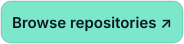
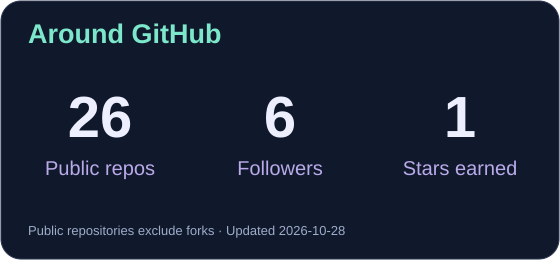
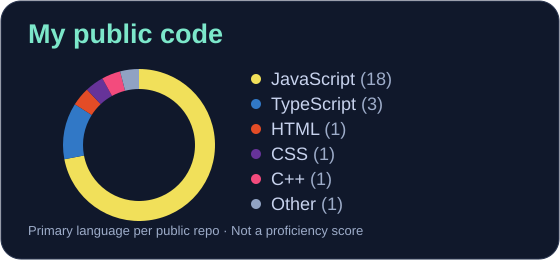

<div align="center">

<picture>
  <source media="(max-width: 640px)" srcset="assets/hero-mobile.svg" />
  
</picture>


<p>
  <a href="https://github.com/Hashamjavedofficial?tab=repositories"></a>
  <a href="#-contribution-snake"></a>
  <a href="mailto:hasham.hasham1@gmail.com"></a>
</p>

**[SNAKE](#-contribution-snake)** &nbsp; / &nbsp; **[STACK](#-tech-stack)** &nbsp; / &nbsp; **[STATS](#-github-stats)** &nbsp; / &nbsp; **[REPOS](#-public-repos)**

</div>

### Hey, I'm Hasham 👋

Full-stack developer. I like connecting useful things—and making the complicated parts feel simple.

```ts
const me = {
  stack: [
    "React", "Next.js", "TypeScript",
    "Node.js", "NestJS", "SQL", "cloud"
  ],
  building: ["AI agents", "MCP"],
  learning: ["Python", "FastAPI", "LLMs"]
};
```

## 🐍 Contribution snake

<a href="https://github.com/Hashamjavedofficial?tab=overview">
  <picture>
    <source media="(prefers-reduced-motion: reduce) and (max-width: 640px)" srcset="assets/github-activity-mobile.svg" />
    <source media="(prefers-reduced-motion: reduce)" srcset="assets/github-activity.svg" />
    
  </picture>
</a>

<p align="center"><sub>My contribution history, one square at a time. Refreshed daily.</sub><br />
<a href="https://github.com/Hashamjavedofficial?tab=overview">View the original contribution calendar ↗</a></p>

## 🔧 Tech stack

<div align="center">

<h4>Frontend</h4>

<p><sub>React · Next.js · TypeScript · Vue · Nuxt · Tailwind · React Native</sub></p>

<h4>Backend &amp; databases</h4>

<p><sub>Node.js · NestJS · Express · PostgreSQL · MySQL · MongoDB · SQL Server</sub></p>

<h4>Cloud &amp; tools</h4>

<p><sub>Azure · AWS · Docker · Git · GitLab CI/CD · Firebase</sub></p>


</div>

## 📊 GitHub stats

<div align="center">
  <a href="https://github.com/Hashamjavedofficial?tab=repositories"></a>
  <a href="https://github.com/Hashamjavedofficial?tab=repositories"></a>
</div>

<p align="center"><sub>Updated daily from GitHub. Public activity is one part of my work.</sub><br />
<a href="https://github.com/Hashamjavedofficial?tab=repositories">All repositories</a> · <a href="https://github.com/pulls?q=is%3Apr+author%3AHashamjavedofficial">Pull requests</a></p>

## 🧪 Public repos

Templates, experiments, and things I've learned along the way.

- **[RN-BoilerPlateX](https://github.com/Hashamjavedofficial/RN-BoilerPlateX)** — a React Native app template.
- **[Next.js authentication](https://github.com/Hashamjavedofficial/nextjs-authentication-with-mongoose-next-connect)** — an experiment with Mongoose and next-connect.
- **[React OpenAQ Comparison](https://github.com/Hashamjavedofficial/React-OpenAQ-Comparison)** — air-quality comparisons with React.

---

<p align="center"><sub>Code. Connect. Experiment.</sub><br />
<a href="mailto:hasham.hasham1@gmail.com">Email</a> · <a href="https://hashamjavedofficial.github.io/developerFolio/">Portfolio</a> · <a href="https://www.linkedin.com/in/hashamjaved/">LinkedIn</a></p>
